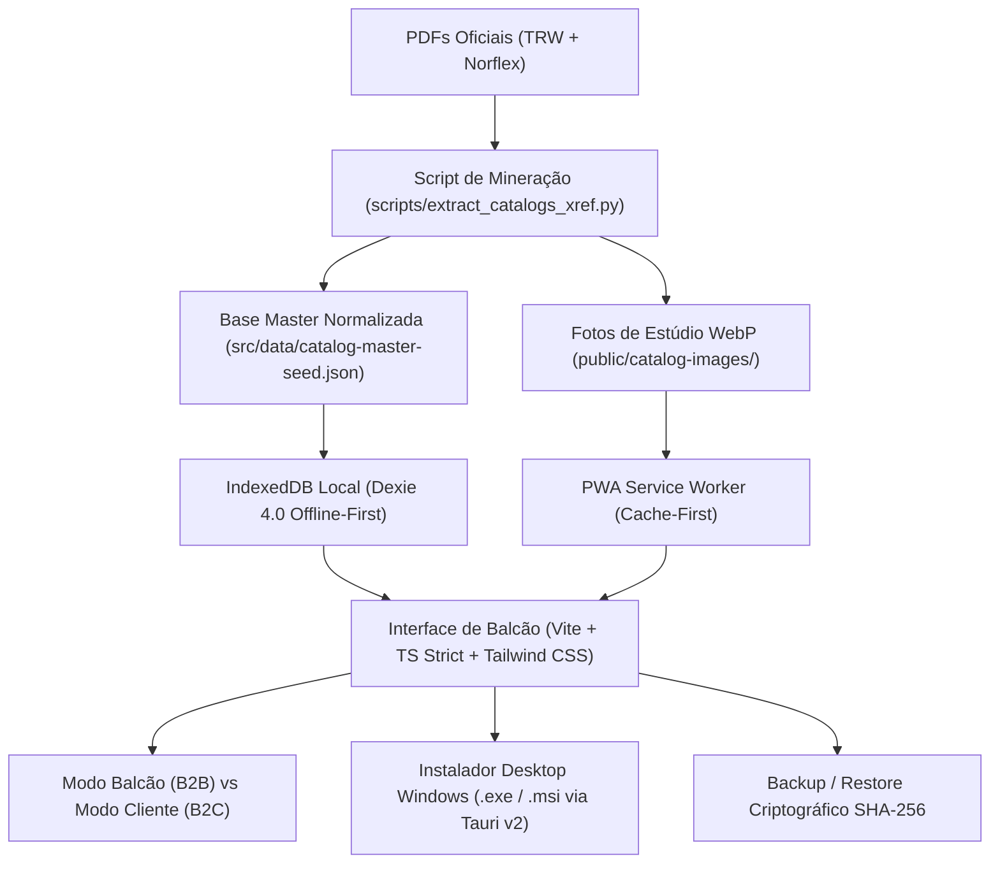

# 🚗 Catálogo de Flexíveis de Freio Pro (TRW & Norflex)
## Sistema Inteligente de Balcão Offline-First (PWA + Tauri v2 Windows Desktop)

[](https://wallacextreme.github.io/catalogo-flexiveis-freio/)
[](https://github.com/wallacextreme/catalogo-flexiveis-freio)
[](https://github.com/wallacextreme/catalogo-flexiveis-freio#--status-dos-9-quality-gates)

🌐 **Acesse o PWA Online no Navegador ou Instale no Celular / PC:**  
👉 **[https://wallacextreme.github.io/catalogo-flexiveis-freio/](https://wallacextreme.github.io/catalogo-flexiveis-freio/)**

> **Padrão de Engenharia:** Conforme especificação oficial `ARQUITETURA_CATALOGOS.md` (Python XREF/SMask + Offline-First + UI-UX-PRO-MAX)  
> **Fontes Originais:** `trw-flexiveis-para-freios.pdf` (48 páginas) + `441884238-Norflex-Catalogo-Flexivel-2019.pdf` (54 páginas)  
> **Resultado:** **825 peças**, **746 fotos de estúdio WebP**, **1.551 vínculos cruzados**, **574 aplicações veiculares estruturadas**, busca sub-50ms (3.09ms medidos) e persistência offline-first.

---

## 🏛️ Arquitetura do Sistema



---

## 🛡️ Status dos 9 Quality Gates

| # | Quality Gate | Status | Métrica / Evidência |
|---|---|:---:|---|
| **Gate 1** | **Extração Sem Perdas (Zero Data Loss)** | **APROVADO** | 825 peças únicas (269 TRW + 556 Norflex), 574 aplicações veiculares, códigos OEM expandidos |
| **Gate 2** | **Fotos de Estúdio & Zero Black Images** | **APROVADO** | 746 fotos `.webp` (quality=92) auditadas no disco. **0 imagens pretas** |
| **Gate 3** | **Integridade de Vínculos Cruzados** | **APROVADO** | **1.551 vínculos** computados nos 4 tipos (`EQUIVALENCIA_DIRETA`, `COMPATIBILIDADE_ACOPLAMENTO`, `COMPOSICAO_KIT`, `VARIANTE_PRODUTO`) |
| **Gate 4** | **IndexedDB & Isolamento de Inventário** | **APROVADO** | Auto-seed instantâneo; tabela `inventoryOverrides` protege preços, estoque e localização física |
| **Gate 5** | **Motor de Busca Sub-50ms (4 Níveis)** | **APROVADO** | **3.095 ms/busca** em benchmark com 1.000 iterações (ranking SKU -> OEM -> Veículo/Ano -> Medida) |
| **Gate 6** | **Galeria Híbrida Multi-Ângulos** | **APROVADO** | Suporte a `staticImageUrls`, Drag & Drop, `Ctrl+V` (WebP client-side 0.92) e Lightbox 50%–400% |
| **Gate 7** | **UX Balcão, Gestão & Lucide SVG** | **APROVADO** | Modal de gestão manual (`product-form-modal.ts`), Modo Cliente (privacidade), WhatsApp, 100% SVG Lucide, 0 emojis |
| **Gate 8** | **Offline-First & Empacotamento Multiplataforma**| **APROVADO** | PWA Workbox Cache-First (`sw.js`) + Tauri v2 Desktop (`src-tauri/`) com ícones nativos válidos |
| **Gate 9** | **Tipagem Estrita & Testes Automatizados** | **APROVADO** | 12/12 testes passando (`bun test`), 0 erros em `tsc --noEmit`, build de produção `bun run build` PASS |

---

## ⚡ Comandos de Execução

### 1. Mineração e Extração dos PDFs (Python XREF + OCR)
```bash
python scripts/extract_catalogs_xref.py
```

### 2. Executar Suíte de Testes Automatizados e Benchmark Sub-50ms
```bash
bun test
```

### 3. Verificação Estrita de Tipos TypeScript (0 Erros)
```bash
bun x tsc --noEmit
```

### 4. Compilação de Produção PWA
```bash
bun run build
```

### 5. Executar em Desenvolvimento
```bash
bun run dev
```

### 6. Compilar Instalador Desktop Windows Nativo (.msi / .exe)
```bash
bun run tauri build
```
